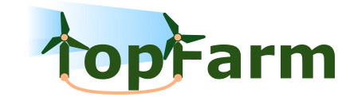

[](https://gitlab.windenergy.dtu.dk/TOPFARM/TopFarm2/commits/master)
[](https://gitlab.windenergy.dtu.dk/TOPFARM/TopFarm2/commits/master)
[](https://doi.org/10.5281/zenodo.3247031)
[](https://pypi.org/project/topfarm/)
[](https://gitlab.windenergy.dtu.dk/TOPFARM/TopFarm2/blob/master/LICENSE)
[](https://mybinder.org/v2/git/https%3A%2F%2Fgitlab.windenergy.dtu.dk%2FTOPFARM%2FTopFarm2.git/HEAD)

## TOPFARM

TOPFARM is a plant-level wind farm optimization framework developed by DTU Wind and Energy Systems. It is built on top of [OpenMDAO](https://openmdao.org/) and integrates with [PyWake](https://topfarm.pages.windenergy.dtu.dk/PyWake/) for aerodynamic wake modelling and [OptiWindNet](https://topfarm.pages.windenergy.dtu.dk/OptiWindNet/) for electrical cable network optimisation.

### Features

- **Layout optimization** - optimize turbine x/y positions subject to boundary and spacing constraints
- **Type optimization** - select turbine types to maximize AEP or economic objectives
- **Hub height optimization** - jointly optimize layout and hub heights
- **Nested optimization** - chain multiple optimization problems
- **Smart Start** - data-driven initialization to avoid poor local optima
- **Multiple drivers** - gradient-based (SLSQP, IPOPT), genetic algorithms, stochastic gradient descent
- **Recorders** - save and replay full optimization trajectories

### Quick Start

```python
import numpy as np
from topfarm import TopFarmProblem
from topfarm.cost_models.cost_model_wrappers import CostModelComponent
from topfarm.easy_drivers import EasyScipyOptimizeDriver
from topfarm.constraint_components.spacing import SpacingConstraint
from topfarm.constraint_components.boundary import XYBoundaryConstraint

n_wt = 4
boundary = [(0, 0), (1000, 0), (1000, 1000), (0, 1000)]

def aep_func(x, y, **kwargs):
    # Replace with a wake model, e.g. PyWake.
    return 4e6 - np.sum((x - 500)**2 + (y - 500)**2)

problem = TopFarmProblem(
    design_vars={'x': (np.zeros(n_wt), 0, 1000), 'y': (np.zeros(n_wt), 0, 1000)},
    cost_comp=CostModelComponent(['x', 'y'], n_wt, aep_func, maximize=True),
    constraints=[SpacingConstraint(200), XYBoundaryConstraint(boundary)],
    driver=EasyScipyOptimizeDriver(),
)
cost, state, recorder = problem.optimize()
```

### Installation

```bash
pip install topfarm
```

For the latest development version:

```bash
pip install git+https://gitlab.windenergy.dtu.dk/TOPFARM/TopFarm2.git
```

See the [Installation Guide](https://topfarm.pages.windenergy.dtu.dk/TopFarm2/installation.html) for Conda environments, developer setup, and troubleshooting.

### Documentation

Full documentation, notebooks, and examples are at:
**https://topfarm.pages.windenergy.dtu.dk/TopFarm2**

### Contributing

Contributions are welcome! Please read [CONTRIBUTING.md](CONTRIBUTING.md) before opening a pull request.

### Citation

If you use TOPFARM in your research, please cite:

> Rethore, P.-E. et al. *TOPFARM: Multi-fidelity Optimization of Wind Farms*. Zenodo. https://doi.org/10.5281/zenodo.3247031
